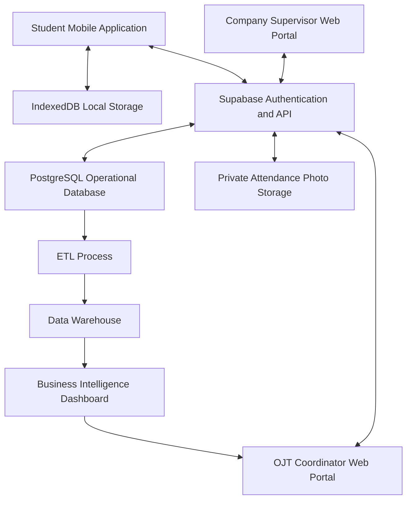

# InternTrack

### OJT Weekly Report and DTR Monitoring System

InternTrack is a multi-user On-the-Job Training (OJT) Management and Monitoring System designed to centralize attendance recording, Daily Time Record (DTR) management, weekly accomplishment reports, attendance verification, and internship progress monitoring.

The system integrates an offline-capable mobile application for Student Interns, a web application for Company Supervisors and OJT Coordinators, and a centralized cloud database with role-based access control, audit logging, and business intelligence capabilities.

---

## System Objectives

- Centralize internship records and monitoring activities.
- Support attendance recording even without internet connectivity.
- Improve the reliability and accountability of attendance records.
- Simplify attendance verification and weekly report review.
- Provide accurate internship progress information.
- Support data-driven decisions through business intelligence.

## System Users

| User Role | Platform | Responsibilities |
|---|---|---|
| Student Intern | Mobile Application | Record attendance, manage DTR, submit weekly reports, and monitor internship progress |
| Company Supervisor | Web Application | Verify attendance, review weekly reports, and monitor assigned interns |
| OJT Coordinator | Web Application | Manage accounts, assign interns, monitor internship activities, and analyze institutional data |

## Key Features

### Student Intern

- Student ID authentication
- Personalized dashboard
- Attendance recording with photographic evidence and GPS coordinates
- Offline attendance recording and synchronization
- Digital Daily Time Record (DTR)
- Weekly DTR PDF generation
- Weekly accomplishment report submission
- Verified and provisional attendance monitoring
- Internship hours and completion progress monitoring
- Student profile and internship information

### Company Supervisor

- Email and password authentication
- Supervisor dashboard
- Assigned intern management
- Individual intern progress monitoring
- Attendance review and verification
- Attendance rejection with remarks
- Weekly accomplishment report review
- Report approval and return workflow
- Supervisor profile management

### OJT Coordinator

- Email and password authentication
- Administrative dashboard
- Student intern registration and management
- Company supervisor management
- Account status management
- Intern-supervisor assignment and reassignment
- Attendance monitoring
- Weekly report monitoring
- Student DTR and internship records
- Business intelligence dashboard
- Coordinator profile management

---

## System Architecture

InternTrack follows a hybrid cloud and offline-first architecture.



The mobile application supports local attendance storage and synchronization, while the web portals communicate with the centralized Supabase backend.

Operational and analytical data are maintained in separate schemas within the PostgreSQL database.

## Technology Stack

| Technology | Purpose |
|---|---|
| Angular | Application framework |
| Ionic Framework | Mobile and web user interface |
| TypeScript | Application development |
| HTML and SCSS | Interface structure and styling |
| Capacitor | Native Android integration |
| Supabase | Cloud backend services |
| PostgreSQL | Relational database management |
| Supabase Auth | User authentication |
| Supabase Storage | Attendance photo storage |
| Supabase Edge Functions | Server-side authentication operations |
| IndexedDB | Local offline data storage |
| PDF.js | PDF document processing |
| pdfmake | PDF document generation |
| Git and GitHub | Version control and collaboration |

---

## Database Architecture

InternTrack uses PostgreSQL for centralized relational data management and IndexedDB for local offline storage.

### Operational Database

The public schema contains eight operational tables.

| Table | Purpose |
|---|---|
| users | User accounts, roles, and account status |
| students | Student information and internship requirements |
| company_supervisors | Company supervisor information |
| ojt_coordinators | OJT coordinator information |
| intern_supervisor_assignments | Intern-supervisor assignments and assignment history |
| attendance | Time-in, time-out, photographic evidence, GPS coordinates, and verification records |
| reports | Weekly accomplishment reports and review information |
| audit_logs | Database activity and change history |

### Database Views

| View | Purpose |
|---|---|
| student_assignments | Consolidated student assignment information |
| supervisor_interns | Consolidated supervisor and assigned intern information |

Both views use the security invoker configuration to respect the calling user's database permissions and applicable row-level security policies.

## Database Security

InternTrack implements multiple layers of database security.

- Supabase Authentication
- Role-based access control
- PostgreSQL Row-Level Security (RLS)
- Database-level GRANT permissions
- Database constraints and validation
- Protected attendance and account fields
- Assignment-based supervisor access
- Private attendance photo storage
- Database audit logging
- Restricted data warehouse access
- Authorization checks within analytical functions

### Role-Based Access

| Resource | Student Intern | Company Supervisor | OJT Coordinator |
|---|---|---|---|
| Student records | Own records | Assigned interns | Authorized institutional records |
| Attendance | Own records | Assigned interns | Monitoring access |
| Attendance verification | Not permitted | Assigned interns | Monitoring access |
| Weekly reports | Own reports | Assigned interns | Monitoring access |
| Intern assignments | Restricted | Assigned interns | Management access |
| Business intelligence | Not permitted | Not permitted | Authorized access |

Access is further restricted by database policies, account status, assignment relationships, and protected field rules.

### Audit Logging

Database triggers record changes to selected operational tables to support accountability and activity tracking.

Audit records are protected against direct modification by ordinary authenticated users.

---

## Offline Attendance and NoSQL Storage

InternTrack supports attendance recording without an active internet connection.

The student mobile application uses IndexedDB, a browser-based NoSQL storage technology, to temporarily maintain attendance information and pending synchronization operations.

### IndexedDB Database

Database name: `InternTrackOffline`

| Object Store | Purpose |
|---|---|
| attendance_cache | Locally cached attendance records |
| pending_attendance | Attendance transactions awaiting synchronization |
| photos | Locally stored attendance photo files |

### Synchronization Workflow

1. The student records attendance.
2. Attendance information and photographic evidence are stored locally when necessary.
3. Pending attendance transactions are maintained in IndexedDB.
4. Synchronization is attempted when connectivity becomes available.
5. Attendance information and photos are transferred to the cloud backend.
6. Successfully synchronized records become available for supervisor review.

The synchronization process uses client transaction identifiers and retry mechanisms to support reliable attendance submission.

## Attendance Verification

Student Interns record Time-In and Time-Out information with photographic evidence and location coordinates.

Company Supervisors review synchronized attendance records belonging to their assigned interns.

Attendance records use the following verification statuses:

| Status | Description |
|---|---|
| Provisional | Attendance awaiting supervisor verification |
| Verified | Attendance accepted by the assigned supervisor |
| Rejected | Attendance rejected with corresponding remarks |

Database triggers protect attendance fields and enforce verification restrictions.

Only verified and synchronized attendance hours contribute to official internship completion progress.

## Daily Time Record

InternTrack provides digital Daily Time Record management with:

- Attendance date and time information
- Daily rendered hours
- Attendance verification indicators
- Verified and provisional hour summaries
- Internship completion progress
- Weekly PDF generation

## Weekly Accomplishment Reports

Student Interns can prepare and submit weekly accomplishment reports for supervisor review.

The report workflow supports:

- Draft preparation
- Report submission
- Supervisor review
- Report approval
- Report return with feedback

---

## Data Warehouse and Business Intelligence

InternTrack includes a dedicated analytical schema for internship monitoring and institutional decision support.

The data warehouse follows a star schema consisting of one fact table and four dimension tables.

### Warehouse Structure

| Table | Type | Purpose |
|---|---|---|
| fact_attendance | Fact | Attendance measures and verification information |
| dim_date | Dimension | Attendance dates and reporting periods |
| dim_student | Dimension | Student-related analytical information |
| dim_company | Dimension | Company-related analytical information |
| dim_supervisor | Dimension | Supervisor-related analytical information |

### Extract, Transform, and Load (ETL)

The ETL process is implemented using PostgreSQL functions.

1. Extract attendance and related information from operational tables.
2. Transform operational records into analytical dimensions and measures.
3. Load dimension tables and attendance facts into the warehouse.
4. Reconcile warehouse records with the operational database.

The warehouse uses an on-demand full-refresh process.

### Analytical Functions

| Function | Purpose |
|---|---|
| warehouse.refresh_attendance_warehouse() | Refresh warehouse dimensions and attendance facts |
| public.refresh_internship_analytics() | Authorized warehouse refresh operation |
| public.get_internship_analytics() | Retrieve authorized analytical results |

Direct warehouse access is restricted. The coordinator dashboard retrieves analytical information through authorized database functions.

### Business Intelligence Dashboard

The coordinator dashboard provides analytical information such as:

- Student intern population
- Company and supervisor counts
- Attendance record distribution
- Verified, provisional, and rejected attendance
- Attendance verification rate
- Total verified internship hours
- Weekly verified attendance hours

These indicators support internship monitoring, attendance review prioritization, and institutional reporting.

---

## Database Performance and Recovery

Database performance and recovery experiments were conducted in a separate local PostgreSQL testing environment.

The experiments include:

- Synthetic operational data generation
- SQL query performance analysis
- Execution plan inspection
- Index-based query optimization
- Database backup creation
- Database restoration and record reconciliation

The local testing environment is separate from the live Supabase database.

Performance and recovery results are documented in the accompanying academic technical documentation.

---

## Repository Structure

```text
InternTrack/
├── android/
├── database/
│   ├── schema/
│   │   └── 07_final_schema_with_warehouse.sql
│   ├── storage/
│   │   └── 08_final_storage_policies.sql
│   └── security/
│       └── 09_final_database_permissions.sql
├── e2e/
├── src/
│   ├── app/
│   │   ├── pages/
│   │   ├── services/
│   │   ├── coordinator-layout/
│   │   └── supervisor-layout/
│   ├── assets/
│   └── environments/
├── supabase/
│   └── functions/
│       └── student-login/
├── README.md
└── package.json
```

### Database Scripts

| File | Description |
|---|---|
| 07_final_schema_with_warehouse.sql | Final operational and analytical database schema |
| 08_final_storage_policies.sql | Private attendance photo bucket and storage access policies |
| 09_final_database_permissions.sql | Database schema, table, view, and function permissions |

The database scripts are intended as technical references and restoration resources.

They do not contain production data backups or authentication records.

Restoration requires a compatible Supabase environment, appropriate database roles, and required backend configuration.

---

## Getting Started

### Prerequisites

- Node.js and npm compatible with the project dependencies
- Git
- Android Studio for Android development
- Authorized Supabase project access

### Installation

Clone the repository:

```bash
git clone https://github.com/str0beri/InternTrack.git
```

Navigate to the project directory:

```bash
cd InternTrack
```

Install dependencies:

```bash
npm ci
```

Configure the Supabase connection using the appropriate environment configuration files.

Only public client configuration values should be included in the frontend application. Service role keys and other private credentials must remain in secure server-side environments.

Start the development server:

```bash
npm start
```

### Available Commands

| Command | Description |
|---|---|
| npm start | Start the development server |
| npm run build | Build the application |
| npm run test:unit | Run unit tests |
| npm run test:e2e | Run end-to-end tests |
| npm run eslint | Run ESLint checks |

### Android Development

Build the application:

```bash
npm run build
```

Synchronize the application with the Android project:

```bash
npx cap sync android
```

Open the Android project:

```bash
npx cap open android
```

Use Android Studio to build and run the application on a compatible Android device.

---

## Project Scope and Limitations

- The Student Intern application is intended for Android mobile devices.
- Company Supervisors and OJT Coordinators access the web application.
- Offline support focuses on attendance recording and synchronization.
- Initial authentication and server synchronization require network connectivity.
- Attendance photos and GPS coordinates serve as supporting evidence and do not independently guarantee physical presence.
- Warehouse data reflects the most recent successful ETL refresh.
- Local database performance results do not represent guaranteed cloud database performance.
- Database restoration scripts require validation in a compatible environment before production use.
- Production data, authentication backups, and private credentials are excluded from the public repository.

## Future Enhancements

- Expanded automated testing
- Improved accessibility
- Notification and reminder mechanisms
- Additional analytical reports
- Automated warehouse refresh scheduling
- Expanded disaster recovery testing
- Continuous integration and deployment

## Project Status

Academic implementation with functional student, supervisor, and coordinator modules.

Further testing, security assessment, and deployment validation are recommended before wider production use.

---

InternTrack | OJT Weekly Report and DTR Monitoring System
